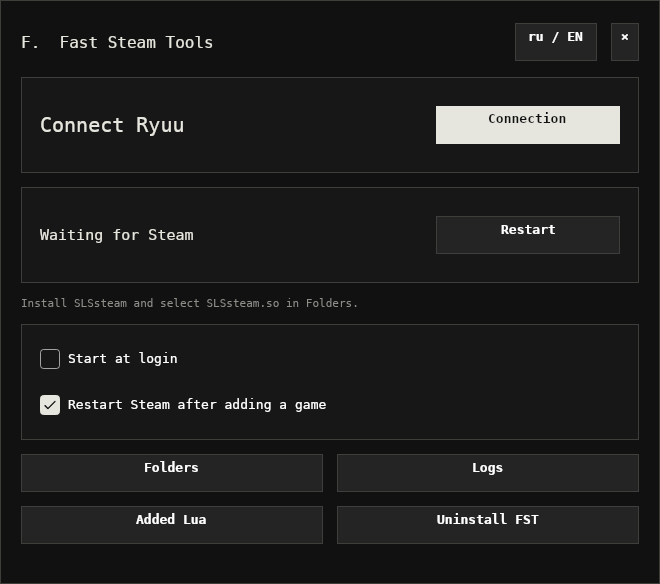

# Fast Steam Tools


FST — утилита для Windows и Linux с кнопкой **«Бесплатно добавить в библиотеку»** на странице игры в Steam. Скачивает Lua и манифесты через ваш аккаунт Ryuu, устанавливает их для совместимого загрузчика и перезапускает Steam.

[Скачать v0.1.0](https://github.com/superhe11/FST/releases/tag/v0.1.0) · [Все релизы](https://github.com/superhe11/FST/releases) · [English](README.en.md)

<details>
<summary>Интерфейс Linux</summary>



</details>

## Что умеет

- Кнопка на страницах магазина Steam и метка Denuvo, если защита указана на странице.
- Подключение Ryuu через Discord с сохранением входа в системном хранилище ключей.
- Работа в трее, настройка автозапуска и перезапуск Steam после установки.
- Интерфейс и логи на русском и английском.
- Список добавленных Lua, поиск по AppID/названию, выбор и удаление нескольких записей.
- Проверка архивов, резервные копии и откат при ошибках установки.

FST не содержит игры, манифесты, чужие ключи или учётные данные. Доступность файлов и лимиты скачивания определяет Ryuu. Установщик FST **не включает Steam-загрузчики**. На Windows FST сам скачивает [OpenSteamTool](https://github.com/OpenSteam001/OpenSteamTool), если в папке Steam нет Lua-загрузчика; на Linux загрузчики устанавливаются отдельно.

## Скачать

Откройте [релиз v0.1.0](https://github.com/superhe11/FST/releases/tag/v0.1.0) и выберите файл:

- **Windows x64:** `FST-Setup.exe` — установщик.
- **Arch Linux x86_64:** `fast-steam-tools-bin-0.1.0-1-x86_64.pkg.tar.zst` — пакет для pacman.
- **Linux x86_64:** `fst-0.1.0-linux-x86_64.tar.gz` — архив с пользовательским установщиком.
- `PKGBUILD` — сборка Arch-пакета из архива релиза; в AUR пакет пока не опубликован.
- `SHA256SUMS.txt` — контрольные суммы скачанных файлов.

Устанавливать .NET для запуска готовых сборок не нужно.

## Установка: Windows

Требования: Windows 10/11 x64 и установленный Steam. Без Lua-загрузчика Steam не читает `config\lua`, и добавленные игры не появляются в библиотеке. Если загрузчика нет (рядом с `steam.exe` нет `OpenSteamTool.dll`, `xinput1_4.dll`, `dwmapi.dll` или `hid.dll`), FST при установке, при запуске и перед добавлением игры скачивает [OpenSteamTool](https://github.com/OpenSteam001/OpenSteamTool) 1.4.8 из официального релиза, сверяет SHA-256 архива и кладёт `dwmapi.dll`, `xinput1_4.dll` и `OpenSteamTool.dll` в папку Steam. Чужие файлы не перезаписываются: уже установленный загрузчик и его каталоги FST использует как есть. OpenSteamTool, установленный самим FST, обновляется при выходе новой версии FST с более новым загрузчиком; изменённые вручную DLL FST не трогает.

OpenSteamTool работает по сигнатурам, которые публикуются отдельно под каждую сборку Steam. После обновления Steam их может не быть несколько дней: тогда при запуске Steam появляются окна ошибок OpenSteamTool, а добавленные игры не видны в библиотеке. FST проверяет это при запуске и после добавления игры и предупреждает в уведомлении. Lua остаются на месте, и игры появятся после обновления OpenSteamTool.

1. Скачайте и запустите `FST-Setup.exe`.
2. При необходимости включите «Запускать вместе с Windows» и нажмите «Установить».
3. Установщик разместит FST в `%LOCALAPPDATA%\FST\bin` и перезапустит обнаруженный Steam.
4. Нажмите **«Готово»** — откроется главное окно FST.
5. Проверьте подключение Ryuu и откройте страницу игры в магазине Steam.

Права администратора не нужны. Если Steam не найден автоматически, выберите его папку через **«Каталоги»**. При запуске Windows FST стартует в трее; нажатие на значок открывает меню.

## Установка: Arch Linux

**Linux-сборка экспериментальная.** Поддерживается нативный Steam из pacman/AUR, архитектура x86_64. Flatpak и Windows Steam через Wine в эту сборку не входят.

### 1. Подготовьте загрузчики

Для нативной загрузки игр нужны **SLSsteam + lumalinux**. Установите их по [официальной инструкции для desktop Linux](https://github.com/jayool/lumalinux#manual-desktop-no-plugin). FST не запускает сторонние установщики и не устанавливает эти библиотеки автоматически.

Сама установка FST не заменяет этот шаг: один SLSsteam регистрирует игры, а lumalinux обеспечивает передачу ключей депотов и работу нативного пути загрузки.

### 2. Установите FST

Скачайте Arch-пакет из релиза, откройте терминал в папке загрузки и выполните:

```bash
sudo pacman -U ./fast-steam-tools-bin-0.1.0-1-x86_64.pkg.tar.zst
fst
```

Зависимости FST устанавливаются через pacman. Для сохранения входа должен работать разблокированный **Secret Service** — например, GNOME Keyring или совместимое хранилище рабочего стола. На Wayland требуется XWayland; для значка трея в GNOME может понадобиться расширение AppIndicator/StatusNotifier.

### Вариант без системного пакета

```bash
tar -xzf fst-0.1.0-linux-x86_64.tar.gz
cd fst-linux-x64
bash install.sh
```

Скрипт спросит про автозапуск и откроет FST после завершающего Enter. Установка выполняется в пользовательский каталог. Подробности: [Linux README](packaging/linux/README-LINUX.md).

### 3. Проверьте каталоги

FST ищет Steam в `~/.steam/steam` и `~/.local/share/Steam`. В **«Каталогах»** можно вручную выбрать папку Steam, `SLSsteam.so` и `liblumalinux.so`.

После первого запуска перезапустите Steam из FST. Если установлен upstream wrapper SLSsteam/lumalinux, FST использует его. Иначе при запуске Steam задаёт `LD_AUDIT` для SLSsteam и `LD_PRELOAD` для lumalinux.

## Подключение Ryuu

1. Нажмите **«Подключение»** или **«Подключить Ryuu»**.
2. FST сначала проверит сохранённое подключение, затем попробует найти сессию через API Ryuu.
3. Если сессии нет, откроется вход через Discord в браузере. Завершите его — FST продолжит подключение автоматически.

После успешного входа ключ хранится в Windows Credential Manager (`FST/Ryuu`) либо Linux Secret Service (`application=fst`, `service=ryuu`). Пароль Discord, cookies браузера и ручное копирование ключей не требуются.

Вход сохраняется между запусками; FST периодически проверяет подключение. Сбой сети или лимит Ryuu не удаляет сохранённый ключ. Разные маршруты VPN у браузера и FST могут мешать обнаружению входа.

**«Отключить» удаляет локальный ключ.** Выход из браузера и локальное отключение не обязательно удаляют сессию на сервере Ryuu: при новом подключении API может вернуть её снова. FST не выдаёт это за новый вход через Discord.

## Добавление и удаление игр

Откройте страницу игры в магазине Steam и нажмите **«Бесплатно добавить в библиотеку»**. FST скачает доступный архив из Ryuu, проверит его и установит Lua/манифесты. Если включён соответствующий чекбокс, Steam будет перезапущен.

FST не исполняет скачанный Lua: допускаются только поддерживаемые декларативные команды. Существующие файлы резервируются; при сбое записи установка откатывается. Работу игры и снятие её DRM FST не гарантирует.

В **«Добавленных Lua»** можно искать по AppID, названию или обоим сразу, выбирать несколько записей и удалять их. Удаление Lua не удаляет установленные игровые файлы. На Linux также убираются принадлежащие FST записи SLSsteam/lumalinux; чужие настройки сохраняются.

## Данные и удаление FST

**Windows:** настройки, логи и резервные копии находятся в `%LOCALAPPDATA%\FST`. Для удаления используйте **«Удалить FST»** в приложении. Удаление всех Lua — отдельная опция, выключенная по умолчанию.

**Linux:** настройки находятся в `${XDG_CONFIG_HOME:-~/.config}/fst`, данные/логи/копии — в `${XDG_DATA_HOME:-~/.local/share}/fst`. Данные lumalinux записываются в `~/.config/lumalinux/keys.txt`.

Пакет pacman удаляется командой:

```bash
sudo pacman -R fast-steam-tools-bin
```

Для пользовательской установки закройте FST через меню трея и запустите `bash uninstall.sh` из распакованного архива. Этот скрипт сохраняет Lua и резервные копии. Кнопка удаления внутри приложения дополнительно предлагает удалить Lua. Удаление FST не удаляет загрузчики Steam, в том числе OpenSteamTool, установленный FST.

## Если что-то не работает

- **Нет кнопки в Steam:** откройте страницу игры в магазине и перезапустите Steam через FST. Для интерфейса используется локальный CEF debug на `127.0.0.1:8080`.
- **Windows не видит игру:** проверьте, что рядом с `steam.exe` есть Lua-загрузчик (в логах FST есть запись об установке OpenSteamTool или ошибке), перезапустите Steam и проверьте каталоги.
- **Linux не видит игру/не скачивает:** проверьте оба загрузчика, их совместимость с текущим Steam и запуск через wrapper. Наличие FST-пакета само по себе не означает, что загрузчики установлены.
- **Ryuu не подключается:** проверьте маршрут VPN, доступность сервиса и лимиты. Кнопка **«Логи»** открывает журнал на языке интерфейса.
- **Linux не сохраняет вход:** установите `libsecret`, запустите и разблокируйте системное хранилище Secret Service.

В [issue](https://github.com/superhe11/FST/issues) укажите ОС, версию FST, способ установки Steam и текст ошибки. Не прикладывайте ключи, cookies и файлы учётных данных.

## Сборка из исходников

Нужен .NET 9 SDK. Все команды выполняются из корня репозитория.

Windows, включая установщик:

```powershell
powershell -NoProfile -File tools/Build-Setup.ps1
```

Результат: `release/FST-Setup.exe`.

Linux, включая архив, Arch-пакет и PKGBUILD:

```bash
bash tools/Build-Linux.sh
```

Помимо SDK нужны `bash`, `tar`, `zstd`, `sha256sum` и стандартные инструменты сборки пакета. Результат находится в `release/`.

## Проверки и статус Linux

```bash
dotnet run --project tests/Fst.Tests/Fst.Tests.csproj -c Release
./release/fst-linux-x64/app/fst --self-test
bash tools/Test-Linux-Package.sh
```

Для v0.1.0 локально прошли **37 проверок ядра** и **32 Linux-проверки**. Проверены сборка Windows, запуск/отрисовка Linux GUI RU/EN, данные Arch-пакета и контрольные суммы. Linux-проверки выполнялись в Linux-окружении WSL, **не на настоящем Arch со Steam**. Скачивание и запуск игры на Arch пока не подтверждены.

Тесты по умолчанию не скачивают игры и не используют Ryuu. Опциональные live-режимы тестового проекта требуют отдельной настройки и могут расходовать лимит сервиса.

## Структура проекта

- `src/Fst.Core` — Ryuu, проверка архивов, установка и каталог Lua.
- `src/Fst.App` / `src/Fst.Setup` — Windows-приложение и установщик.
- `src/Fst.Linux.Platform` / `src/Fst.Linux` — Linux-бэкенд и Avalonia GUI.
- `packaging` — установка Linux, PKGBUILD и лицензии зависимостей.
- `tests` / `tools` — проверки и сборка релиза.

Исходники не содержат RyuuManifestTool/LuaTools, бинарники загрузчиков, пользовательские настройки или ключи. Лицензии поставляемых зависимостей находятся в [`packaging/linux/LICENSES`](packaging/linux/LICENSES).
